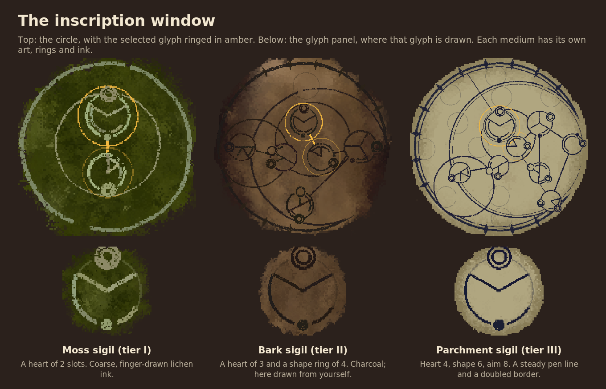

# Mossbound

[](https://github.com/ImJustCookie/MossBound-VS/actions/workflows/ci.yml)

A spell-writing mod for [Vintage Story](https://www.vintagestory.at/) 1.22. Spells are written as circles of glyphs on moss, bark or parchment, then cast. What each glyph means is fixed; what it looks like is secret and different in every world.



Early development (0.x): the script, circles, mixing and the inscription window work; casting exists at test scale. See the [roadmap](docs/roadmap.md).

## Install

The mod zip (`mossbound_<version>.zip`) is published on [Releases](https://github.com/ImJustCookie/MossBound-VS/releases). It goes, unextracted, in the game's `Mods` folder. On multiplayer, it is required on both the server and every client.

## Documentation

- [Writing guide](docs/writing-guide.md): how to write and cast a circle, controls, mishaps
- [Design](docs/design.md): how the mod works, with an [appendix](docs/design-appendix.md) for details
- [Roadmap](docs/roadmap.md): what is built and what comes next
- [Changelog](CHANGELOG.md)

## Development

Requirements: the .NET 10 SDK and Vintage Story 1.22. The build finds the game through the `VINTAGE_STORY` environment variable, which points to the folder containing `VintagestoryAPI.dll`.

```sh
dotnet build mossbound/mossbound.csproj   # build the mod
dotnet test mossbound.Tests               # run the tests
./build.sh                                # package Releases/mossbound_<version>.zip
dotnet format mossbound.sln               # fix formatting and style
```

Pre-commit hooks run the same checks as CI (formatting on commit, tests on push):

```sh
pipx install pre-commit
pre-commit install --install-hooks -t pre-commit -t pre-push
```

Repository layout:

| Path | Contents |
|---|---|
| `mossbound/` | The mod: `Core/` (rules, no game API, unit-tested), `Client/`, `Server/`, `Items/`, `Network/`, `assets/` |
| `mossbound.Tests/` | Unit tests for `Core/` |
| `art/` | Aseprite sources, mirroring the asset tree (not packaged) |
| `docs/` | Design, guide, roadmap; `docs/images/` is generated by `tools/docs-images/run.sh` |
| `CakeBuild/` | Packaging, run by `build.sh` |

Branches follow git flow: work happens on `feature/*` branches, merges into `dev` by pull request, and is released from `dev` to `main`. CI must pass before a merge. Pushing a `v<version>` tag that matches `modinfo.json` creates a draft GitHub release with the zip.
