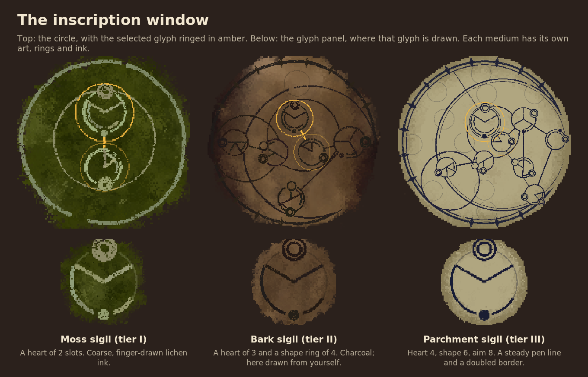

# Mossbound design: appendix

Reference details for [design.md](design.md). Each section is marked **built** or **planned**.

- [A. Glyphs](#a-glyphs)
- [B. Circles](#b-circles)
- [C. Elements and mixing](#c-elements-and-mixing)
- [D. Forms and behaviours](#d-forms-and-behaviours)
- [E. Targeting](#e-targeting)
- [F. Triggers and nested circles](#f-triggers-and-nested-circles)
- [G. Casting](#g-casting)
- [H. Life cost](#h-life-cost)
- [I. Making the media](#i-making-the-media)
- [J. Learning glyphs](#j-learning-glyphs)
- [K. Inscription window](#k-inscription-window)
- [L. Multiplayer and limits](#l-multiplayer-and-limits)
- [M. Code names](#m-code-names)

## A. Glyphs

**Built.**

- 7 points: 6 on a rim, numbered clockwise from the top, and 1 in the middle.
- Lines: **arcs** between neighbouring rim points, and **spokes** from a rim point to the middle.
- Marks, one per point at most: dot, big dot, ring, double ring.
- A glyph is its exact set of lines and marks. Stroke order doesn't matter; orientation does (point 0 faces away from the circle's centre). Recognition is exact, never partial.
- Generated glyphs have 4 to 6 connected lines and 2 or 3 marks.
- Family mark: the same mark on the same point for every glyph of one kind. Chosen per world, different for each kind.
- Stability: the glyph registry is append-only and each glyph is generated independently, so updates never change an existing world's shapes. Snapshot tests guard this.

## B. Circles

**Built.** The aim ring and rim exist in the data model; their glyphs are planned.

### Tiers

| Tier | Medium | Heart | Shape | Aim | Rim | Max size | Choose source |
|---|---|---|---|---|---|---|---|
| I | Moss sigil | 2 | | | | 2 | no |
| II | Bark sigil | 3 | 4 | | | 3 | yes |
| III | Parchment sigil | 4 | 6 | 8 | | 3 | yes |
| IV | Carved stone (planned) | 4 | 6 | 8 | 4 | 3 | yes |

Numbers are slots per ring. Planned lifetimes: moss wilts within a day; bark and parchment are used up on casting; stone is permanent.

### Rules
1. A link joins written glyphs on neighbouring rings, or neighbouring slots of one ring (the last slot neighbours the first). It never skips a ring.
2. Linked heart glyphs form one heart; an unlinked heart glyph is a heart on its own.
3. A cast is a heart plus every glyph reached by following links outward. A group linked to two hearts gives two casts.
4. In a heart, an element glyph of size N counts as N of that element.
5. A glyph in no cast does nothing.
6. The source defaults to the medium; moss allows nothing else.

### Drawn by the game
The server reads only the glyphs, their slots, sizes, links and the source. The client draws the rest:
- **Word circle:** around each cast; grows with the cast's total size and bites into the border.
- **Mix circle:** around each heart of two or more glyphs.
- **Aim line:** from a cast's heart through the end of its aim chain, across the circle.
- **Doubled lines:** for size 3, a mix of three, a cast of three or more glyphs past its heart, and the border from tier III. Never on moss.
- **Border pattern:** plain (medium), thorn diamonds (self), bramble (land).

### Validation
The server rejects a circle unless: every slot exists on the tier, no slot is used twice, every figure is a valid glyph, sizes fit the tier, the source is allowed, links point at existing glyphs, and there are at most 48 glyphs and 96 links. Inscription also checks the linking rule.

## C. Elements and mixing

**Built.** Effects exist only at test scale (section G).

| Element | Intended effects |
|---|---|
| Water | wets, extinguishes, fills |
| Ember | warms, dries, ignites |
| Frost | chills, slows, preserves |
| Stone | hardens, raises earth |
| Life | grows, heals |
| Rot | decays, composts, weakens |
| Wind | pushes, carries, scatters |
| Ward | shields, holds still |

| Mix | Result | Intended effects |
|---|---|---|
| Life + Water + Stone | Moss | spreads living moss |
| Water + Frost | Ice | freezes water, slippery ground |
| Water + Ember | Steam | fog, scalding |
| Water + Life | Rain | waters crops, slow healing |
| Water + Rot | Mire | bog, slows |
| Life + Stone | Root | entangles |
| Life + Rot | Spore | fungus, sleep cloud |
| Life + Ward | Bark | protective skin |
| Frost + Wind | Gale | cold gust, knockback |
| Ember + Wind | Smoke | blinds, calms bees, cures meat |
| Ember + Stone | Coal | lasting heat |
| Stone + Ward | Wall | raises earth or stone |
| Rot + Wind | Blight | withering cloud |

Rules:
1. A heart mixes into exactly one aspect: its glyphs, counted by glyph and never by size, must match one element or one mix (`Core/Spells/Recipes.cs`). Otherwise: **no mix** mishap.
2. Castable now: every element alone, and the mixes Steam, Rain, Smoke. The other mixes in the table are designed but have no recipe yet, so they give **no mix**.
3. A heart's strength is the sum of its glyph sizes; over the medium's limit (moss 2, bark 3, parchment 4): **too strong** mishap. More spells than the medium holds (moss 1, bark 2, parchment 3): **too many spells**. A linked figure that is no glyph: **unknown glyph**.
4. Ember with Frost, or Wind with Ward, in one heart: **opposites** mishap.
5. An element outside the heart: **misplaced** mishap. No element at all: **nothing to cast**.
6. If any heart fails, the whole circle fails.

The full rules, including forms: [spell system](spell-system.md).

What each mishap does: [writing guide](writing-guide.md#when-it-goes-wrong).

## D. Forms and behaviours

**Planned (M5).** Until then every cast acts by touch.

| Form | Effect |
|---|---|
| Touch | on what the caster touches or looks at |
| Seed | thrown; acts where it lands |
| Ring | an area around the caster |
| Mist | a lingering cloud |
| Path | a line along the ground ahead |
| Ward | stays in place and keeps working (tier IV) |
| Imbue | goes into an item: tool, arrow, food, door |

| Behaviour (linked to a form) | Effect |
|---|---|
| Seeking | moves toward the target |
| Delayed | waits before acting |
| Echo | repeats a few times |
| Gentle | weaker and cheaper; safe near allies and crops |

**Modifier marks:** amounts are marks on a form's letter circle: dots for count, short lines for reach, small circles for duration, ticks for speed, 1 to 3 each. Outside the letter increases, inside decreases. The same in every world. Open decisions: [roadmap](roadmap.md#modifier-marks-open-decisions).

## E. Targeting

**Planned (M6).** Aim glyphs are read as a chain, each narrowing the last. With no aim glyph, a cast acts on what the caster looks at, or on the caster.

| Kind | Glyphs |
|---|---|
| Pointers | Me, What-I-look-at, Here, Beneath, Above, Sky |
| Gatherers | Creatures, Plants, Kin, Foes, Items, Water, Ground, Crops, Trees |
| Filters | Near, Far, Closest, All, Not, Wounded, Sleeping, Small, Large, Mine |
| Pronouns (nested circles) | It (what the caller hit), There (where it landed), Source (the caller's target) |
| Names | Bound: a place, item or creature marked earlier |

## F. Triggers and nested circles

**Planned (M8), tier IV.**

- **Triggers:** on landing, on touch, when entered, when the spell ends, at dawn or dusk, when it rains, when hurt.
- **Nested circles** receive It, There and Source, and can nest further.
- **Named circles** can be called from other circles.
- **Control flow:** If (only when an aim glyph finds something), Echo, Each. No variables, no arithmetic.
- **Limits:** maximum nesting depth, caps on glyph executions and targets per cast, bounded recursion. Over a limit, the circle fizzles.

```
main circle    heart: Life           shape: Seed
   rim         trigger: On landing  →  nested circle (receives There)
nested circle  aim: If [Ground is soil] at There
               heart: Life ×2 + Stone (Root)    shape: Touch → a sapling is planted
```

## G. Casting

**Built, test scale.**

| | |
|---|---|
| Inscribe | The server validates the circle and writes it on one medium from the held stack |
| Cast | Hold right-click at least 1 second to charge, release to cast; releasing earlier cancels |
| Target | Creature looked at within 5 blocks, else the block looked at, else the caster |
| Cooldown | 2 seconds per player |
| Medium | Used up, except in creative mode |
| Effects | Each aspect has its own particles, sound and effects (from `config/personalities.json`, see [spell system](spell-system.md)): Ember burns and sets on fire (a wider patch of ground with more strength); Water puts out fire, pushes lightly and leaves its target wet; Frost hurts, slows and chills, and freezes still water around it into ice; Stone bashes, knocks back and roots its target for a moment; Life heals, cures poison and thickens the grass around it; Rot poisons over time, slows and withers grass and flowers; Wind pushes hard, lifts and scatters dropped items; Ward puts a bubble on its target that absorbs damage until it pops or fades; Steam scalds; Rain heals over time and puts out fire; Smoke slows and calms creatures so they stop attacking. Effects react with what the target already carries: Frost on a wet target freezes it in place; Ember on a wet target bursts into scalding steam instead of its own effects; Ember on a chilled target thaws it; Water or Rain on a burning target douses it in steam; Wind on a burning target fans the flames at its feet. Block changes respect land claims. Strength multiplies every effect. Harmful effects never reach other players; a spell cast at nothing lands on yourself |
| Mishaps | Opposites and going over a limit slightly hurt the caster; others fizzle. A hint follows each |

## H. Life cost

**Planned (M9).** The source is saved and validated today but costs nothing.

The cost is computed once per cast from intensity, number of casts, area, duration and nesting.

| Source | Pays with | When it runs out |
|---|---|---|
| Medium (always first) | Stored life: fresh moss most, bark some, stone almost none unless charged | It wilts or crumbles |
| Self | Satiety, then health | Collapse or death |
| Land | Plants, crops, soil nutrients, nearby animals | The area turns barren |

- **Light land use** (small, Gentle, lush area): grass yellows, animals tire, then recover.
- **Heavy land use:** grass dies, leaves wither, crops rot, soil depletes, animals can die.
- **Recovery:** over seasons through the game's own grass spread and growth; faster with Life and Moss spells or replanting.
- **Stored life:** charged moss (jars, moss stones) as carried batteries; tier IV stones fed over days by their surroundings.
- **Overreaching:** a cost beyond what the sources hold is taken from the caster's health, or the land as an uncontrolled drain.
- **Limits:** no drawing from others' land claims; a capped number of blocks and creatures, changed once at cast time.

## I. Making the media

**Planned (M4).** Today: bark sigils come from a knife and a placed log in the crafting grid; the moss and parchment sigils are creative-only.

**Tier I, moss sigil** (on any stone block, no workstation): scrape moss off a mossy block with a knife → lay 5 living moss on stone → flatten with a loose stone in stages → carve with a knife → sneak + right-click with a stick to inscribe. Wilts in about a day.

**Tier II, bark sigil** (scribing stump): strip a placed log with a knife (2–3 bark, leaves a debarked log) → chop a debarked log into a scribing stump (once) → flatten bark on the stump → carve → whittle charcoal into a charcoal stick, which wears down → inscribe on the stump.

**Carving:** like vanilla knapping, a 10×10 grid cut one voxel per knife click to match a pattern. Patterns are JSON recipes; offcuts are lost.

**Building blocks**, reused by later tiers:
- **Work step:** hold with a tool for a time, with sound, particles and animations, giving a result.
- **Carving surface:** the knapping-style sheet.
- **Station:** a block with visible slots for specific items.

All run on the server, rate-limited, one player per piece, nothing running outside an active hold. Steps fall back to particles and sound until their models exist.

## J. Learning glyphs

**Planned (M7).** Random drawing cannot find glyphs. Combinations are learned by experiment (8 elements, 28 pairs).

| Method | For | How |
|---|---|---|
| Listening | elements | Stay with a blank medium at the element's place (Water: springs; Ember: long fires; Frost: snow at night; Stone: deep caves; Life: old forest; Rot: bogs; Wind: peaks in storms; Ward: ruins). Lines appear one by one over a few minutes |
| Fragments | other glyphs | Incomplete glyphs on stones, ruins and old trees. A charcoal rubbing copies one and can be traced in the inscription window |
| Resonance | near misses | Casting a near-correct figure gives warmer/colder feedback, never the answer |
| Family marks | kind | Tell a fragment's kind from its family mark |
| Dreams | rare fragments | Sleeping beside a carved stone |
| Other players | anything | Trade or copy rubbings and notebook pages |

The **field notebook** records drawn or copied glyphs and what happened when they were cast. Players name glyphs themselves.

## K. Inscription window

**Built.** Controls: [writing guide](writing-guide.md#controls).



- **Layout:** circle on the left; selected glyph's panel, help text and buttons on the right.
- **Style:** after Circular Gallifreyan. Pixelated, hand-drawn ink with no anti-aliasing; every irregularity is seeded so redraws never flicker.

  | Tier | Ink | Stroke |
  |---|---|---|
  | I, moss | grey-green | coarse, circles in 3–4 strokes, gaps, thick |
  | II, bark | charcoal | circles in 2–3 strokes, light grain |
  | III, parchment | blue-black | one steady line, doubled border |
  | IV, stone | white | steady, grain, doubled border |

- **Art:** `assets/mossbound/textures/gui/<tier>/canvas.png` (112×112) and `glyphpanel.png` (64×64); 1 art pixel = 4 GUI units; a missing file falls back to a flat colour.
- **Docs images** are rendered by the game's drawing code: `tools/docs-images/run.sh`.

## L. Multiplayer and limits

**Built.**

- The server holds the script, validates every circle, resolves targets, applies effects and consumes media.
- Every input is bounded: 48 glyphs, 96 links, sizes and source per tier; nesting and executions when the rim exists.
- Spells never damage or push players; land claims block land drain.
- Per-player state lives on the server, per world.
- Admin commands (server-control privilege): `/mossbound glyphs` shows the world's glyphs to the admin only; `/mossbound inspect` shows how the server reads the held circle.

## M. Code names

| Concept | Code |
|---|---|
| medium, tier | `ItemCircleMedium`, `CircleTier` |
| circle | `Circle` (saved), `CircleDraft` (being edited) |
| ring, slot | `CircleRing`, `SlotKey` |
| glyph, mark, size | `GlyphFigure`, `Mark`, `PlacedGlyph.Size` |
| link, source | `CircleLink`, `LifeSource` |
| heart, mix, cast | `CircleStructure.Hearts`, `CircleStructure.Mixes`, `Cast` |
| mishap | `Mishap` |
| border, word circle | `CirclePainter.Border`, `WordCircle.Place` |
