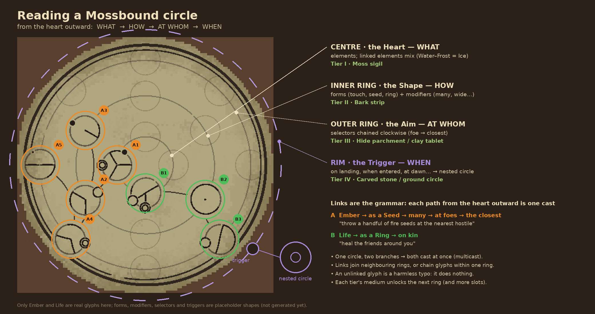

# Mossbound design

Mossbound is a spell-writing mod for Vintage Story. Players write spells as circles of glyphs on a medium and cast them. What each glyph means is fixed; what it looks like is secret and different in every world.

Details, tables and exact numbers are in the [appendix](design-appendix.md). How to write a circle: [writing guide](writing-guide.md). Build order: [roadmap](roadmap.md).

## Principles

1. **Fixed meanings, secret shapes.** The rules are the same in every world; only the glyph shapes are generated from the seed.
2. **Better media say more, not hit harder.** Each tier adds a ring: how a spell travels, what it targets, when it fires.
3. **Results show in the world.** No mana bar and no numbers.
4. **Every spell costs life**, from the medium, the caster or the land.
5. **The server decides.** Clients send only what was written.

## A circle

A **medium** holds one **circle**. The circle has rings of **slots**, and each slot holds one **glyph**. The medium's **tier** decides which rings exist:

| Ring | Says | Tier | Status |
|---|---|---|---|
| Heart (centre) | what: elements | I, moss sigil | built |
| Shape (inner) | how: forms and behaviours | II, bark sigil | planned |
| Aim (outer) | at whom: targets | III, parchment sigil | planned |
| Rim (edge) | when: triggers and nested circles | IV, carved stone | planned |

The **border** shows the **source**, which pays for the spell: the medium, the caster or the land (from tier II).

**Links** join glyphs on neighbouring rings or neighbouring slots. Linked heart glyphs form one **heart**, whose elements mix. A heart plus everything linked outward from it is a **cast**; a circle can hold several, fired together. A glyph's **size** (1 to 3) is its strength. Unlinked glyphs do nothing.

The game draws extra shapes to make a circle readable: word circles, mix circles, aim lines and doubled lines. They never change the spell. → [Appendix B](design-appendix.md#b-circles)

## Glyphs

A glyph is a set of lines and marks on 7 points (6 on a rim, 1 in the middle). Lines run along the rim or to the middle, so they never cross. Each world generates its own shape for every glyph; the server keeps the script and never sends it to players. Glyphs of the same kind share a **family mark**, so a player can tell an element from an aim glyph before knowing what either means. → [Appendix A](design-appendix.md#a-glyphs)

## Elements and mixing (built)

There are 8 elements: Water, Ember, Frost, Stone, Life, Rot, Wind, Ward. Elements linked in one heart mix into exactly one result (Water + Ember gives Steam); glyphs that make no mix fail. Sizes add up to the heart's strength, capped per medium. Opposites (Ember and Frost, Wind and Ward) in one heart make the circle fail. Castable now: every element alone, and Steam, Rain, Smoke. A failed circle gives a **mishap**: it backfires or fizzles. → [Appendix C](design-appendix.md#c-elements-and-mixing)

## Casting (built, test scale)

Inscribe the circle, then hold right-click for at least one second and release to cast it. The medium is used up. Today every spell acts by touch, and only Life, Ember and Wind have real effects. → [Appendix G](design-appendix.md#g-casting)

## Planned systems

- **Spell system** (M5 onward): how a circle becomes a spell: one aspect per heart and one form per form group, sizes as strength and scale, hand-made spells over aspect personalities, modifiers, origins, rendering. → [spell-system.md](spell-system.md)
- **Forms and behaviours** (shape ring, M5): how a cast travels (Touch, Seed, Ring, Mist...) and how it acts (Seeking, Delayed, Gentle...). Amounts become marks on a form's letter. → [D](design-appendix.md#d-forms-and-behaviours)
- **Targeting** (aim ring, M6): glyphs read as a chain, each narrowing the last: *creatures → near → not kin → closest*. → [E](design-appendix.md#e-targeting)
- **Triggers and nested circles** (rim, M8): a rim glyph fires a nested circle on an event; nested circles work like functions, with strict limits. → [F](design-appendix.md#f-triggers-and-nested-circles)
- **Life cost** (M9): each cast costs life from the medium, then the caster (hunger, then health) or the land (plants, soil, animals). Overuse can kill the caster or leave land barren for seasons. → [H](design-appendix.md#h-life-cost)
- **Making the media** (M4): media are made in the world with tools, step by step, like knapping. → [I](design-appendix.md#i-making-the-media)
- **Learning glyphs** (M7): from places in nature, fragments on ruins, near-miss feedback and other players, recorded in a field notebook. → [J](design-appendix.md#j-learning-glyphs)
