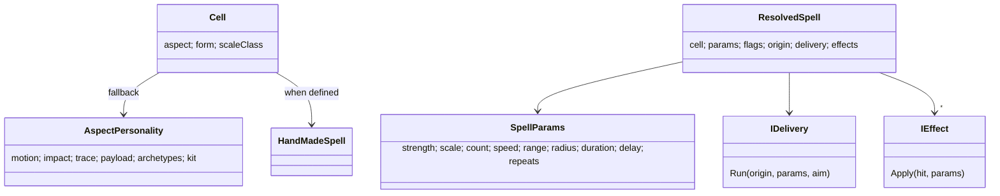
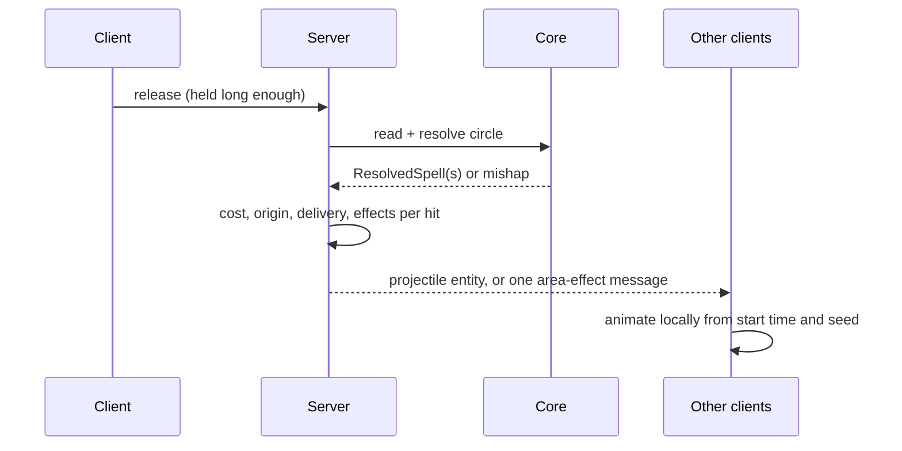

# Spell system

**Planned (M5 onward).** The reference for how a written circle becomes a spell: what each glyph decides, how parts combine and fail, how spells get their identity and look, and how the server runs them. It replaces the test-scale casting of [Appendix G](design-appendix.md#g-casting) once built; [What changes in built behaviour](#what-changes-in-built-behaviour) lists the differences.

## Goals

- **Hand-made spells.** Meteor, Shield dome, Summon: spells with their own mechanic, look and name, not a recoloured effect.
- **Every combination works.** A combination with no hand-made spell still feels deliberate.
- **Freedom through the grammar.** Mixing, sizes, marks, behaviours, aim chains and nested circles give far more spells than anyone writes by hand.
- **Built in steps.** M5 ships a small set; content grows one spell at a time without changing the system.

## Version 0

The first build: the smallest version that is fun to play. It keeps the same structure (cells, hand-made spells over personalities, reading and resolving in Core), so every later layer is added without rework. Everything else in this document comes after v0.

| Part | v0 | After v0 |
|---|---|---|
| Heart | one aspect per heart, the new mix rule, strength = sum of sizes | |
| Forms | Touch, Seed, Ring; one form per group; loose forms make separate spells | form compounds, Mist, Path |
| Scale | sizes give a scale number; variants only for the hand-made spells | variants for more cells |
| Personality | the full personality (motion, impact, trace, payload, material kit); each form has **one** archetype, customised by it | several archetypes per form, picked by the aspect |
| Hand-made spells | a few showcase cells | grows over time |
| Modifiers | none | marks, behaviours |
| Origin and aim | caster; what the caster looks at | other origins, the aim chain (M6) |
| Effects | what the first personalities need | more |
| World reactions | only inside hand-made spells | the interaction table |
| Traces | patch (on the ground) and cloud (in the air), one ticking-zone runner | growth |
| Ward | a bubble that absorbs a set amount of damage, then pops or fades | |
| Discovery | a successful cast records each heart as written, for the caster; discovered hearts show their own colours in that player's charge visuals, undiscovered ones look neutral. The base for a future player journal | the journal |
| Rendering | one archetype per form, painted by the aspect's material kit; Seed as a projectile entity with a variant per aspect; Ring as one server message animated by every client | more archetypes |
| Saving spells | not needed | saveable `ResolvedSpell` (Imbue, Delayed, triggers) |

## Words

| Word | Meaning |
|---|---|
| **Cast** | a heart and everything linked out from it (`CircleStructure.Casts`) |
| **Heart** | heart-ring glyphs linked together; mixes into one **aspect** |
| **Form group** | shape-ring glyphs of one cast linked together; mixes into one **form** |
| **Aspect** | an element (Ember) or an element compound (Steam) |
| **Form** | how a spell travels and acts (Seed) or a form compound (Burst) |
| **Strength** | how hard a spell hits: from the heart's glyph sizes |
| **Scale** | how big a spell is, and which variant: from the form group's glyph sizes |
| **Cell** | aspect + form + scale class: what a spell is |

## Reading a circle

Each cast is read on its own, in four steps.

### 1. The heart mixes into one aspect

- The mix depends only on **which glyphs** are in the heart, counted by glyph, never by size.
- The heart must match **exactly one** entry: a single element, or a compound in the compound table. Otherwise the cast fails.
- A compound may repeat an element: two Ember glyphs can be their own compound, while one Ember glyph of size 2 is plain Ember, bigger.
- Examples:

| Heart glyphs | Result |
|---|---|
| Ember | Ember |
| Water + Ember | Steam |
| Life + Water + Stone | Moss |
| Ember + Ember (two glyphs) | the compound defined for it, if any; otherwise fails |
| Life + Water + Stone + Ember | no such compound: fails |
| Ember + Frost | opposites: fails harder (see mishaps) |

### 2. The form group mixes into one form

Same rule as the heart:
- **Which glyphs**, not sizes; exactly one form or form compound, otherwise the cast fails.
- **No form at all** is not a failure: the cast is **Touch**, so moss sigils (no shape ring) work.

Proposed form compounds (to design):

| Forms | Compound | Behaviour |
|---|---|---|
| Seed + Ring | Burst | flies, then bursts into a ring where it lands |
| Seed + Mist | Cloud bomb | lands and leaves a lingering cloud |
| Ring + Mist | Shroud | a cloud that stays around the caster |
| Seed + Path | Roller | rolls along the ground |
| Touch + Ring | Shockwave | a cone of force from the hand |
| Ring + Path | Rampart | a line of the aspect rising from the ground |
| Seed + Ring + Mist | Tempest | a travelling storm (showcase) |

**Loose forms.** Forms linked to the heart but not to each other are separate groups: each makes its own spell with the cast's aspect. Linking them is how a compound is written.

### 3. Sizes set strength and scale

| Glyphs | Their sizes give | Rule |
|---|---|---|
| Heart | **strength**: damage, healing, push force | sum of the heart's glyph sizes, capped per tier |
| Form group | **scale**: size, radius, range; and the **variant** | sum of the group's glyph sizes, capped per tier |

The scale class picks the variant when a hand-made spell has several:

| Cell | Scale 1 | Scale 2 | Scale 3 |
|---|---|---|---|
| Ember + Seed | Spark | Fireball | Fire comet |
| Stone + Seed | Pebble shot | Boulder | Meteor (falls from the sky, leaves a crater) |
| Ward + Ring | Personal barrier | Shield dome | Fortress dome |
| Life + Touch | Mend | Heal | Revive |

A cell with no variant for a scale uses its nearest one, grown or shrunk.

### 4. Mishaps

| Mishap | Cause | Effect |
|---|---|---|
| **Opposition** | opposites together in one heart (Ember + Frost, Wind + Ward), or in one form group (proposed: Seed + Ward, Imbue + Ring) | backfire: hurts the caster |
| **No mix** | a heart or form group that matches no entry | fizzle |
| **Too strong** | a heart's strength over the tier cap | backfire |
| **Too large** | a form group's scale over the tier cap | backfire |
| **Too many spells** | more spells from one circle than the tier allows | backfire |
| **Unknown glyph** | a linked figure that is no glyph (unlinked ones are ignored) | fizzle |
| **Misplaced** | an element outside the heart, or a form outside the shape ring | fizzle |
| **Nothing to cast** | no element at all | fizzle |

If any cast fails, the whole circle fails, as today.

### Limits per tier (values to tune)

| Tier | Strength cap | Scale cap | Spells per circle |
|---|---|---|---|
| I, moss | 3 | (no shape ring) | 1 |
| II, bark | 6 | 4 | 2 |
| III, parchment | 6 | 6 | 4 |

## What a spell is: the cell

Each cell resolves through the first layer that defines it:

| Layer | Gives | Written as |
|---|---|---|
| **Hand-made spell** | its own mechanic (crater, blocking, creature AI), model, name, variants | a class plus data, added over time |
| **Aspect personality × form** | a spell built from the aspect's character, expressed by the form | data per aspect, one delivery per form |

Every cell has the second layer, so no combination is missing. Hand-made spells replace cells one at a time.

### Aspect personality

One entry per aspect (8 elements, the compounds). Compounds borrow their parents' entries until they get their own. In v0 each form has a single archetype, so the archetype pick comes after.

| Field | Values (examples) | Used by |
|---|---|---|
| Motion | straight, arc, heavy, drift, wobble, hover | how it travels (Seed, Path) |
| Impact | burst, splash, shatter, stick, spread, pass-through | what happens on contact |
| Trace | none, patch, cloud, growth | what it leaves behind |
| Payload | damage, heal, push, slow, ignite, wet, grow, shield | its effects on each hit |
| Archetype per form | Ring: wave / spikes / pulse / creep / dome; Seed: orb / shard / lump / wisp | its outline (see Rendering) |
| Material kit | render style, textures, particles, motion flavour, light, sound | its look |

Example cells with no hand-made spell:
- **Rot + Ring:** a dark ring that creeps over the ground, oozing, weakening what it reaches.
- **Ember + Ring:** a flame wall rolling outward, igniting grass.

### Names

Generated from an aspect adjective and a form noun ("Rotting Ring"), with hand-written names for any cell or variant that deserves one ("Fireball", "Meteor"). All names are lang keys.

## Modifiers

**After v0.**

| Kind | Examples | What it changes |
|---|---|---|
| **Marks** on a form's letter (1–3, outside more, inside less) | count, reach, duration, speed | numbers only |
| **Behaviour glyphs** linked to a form | Seeking, Gentle | a flag read by the delivery or the effects |
| | Delayed, Echo | time: delay, repeats, interval, handled by the runner for every form |

Modifiers never add mechanics; a swarm of slow fireballs is five fireballs, small and slow, that still flicker and burst.

## Where a spell starts, and what it hits

- **Origin:** where the delivery starts and first points. Chosen by data until M8:
  1. the medium, for placed circles (M8);
  2. the cell's default (Meteor starts above the target);
  3. otherwise the caster.

  Origins: `caster`, `target` (pushed out from a block face), `above-target`, `medium`, `caller` (M8 nested circles: It, There).
- **Aim:** the aim chain filters what the delivery reaches. With no aim glyph: what the caster looks at, else the caster.
- **Empty aim:** the spell goes off, hits nothing, and the medium is used up. The If glyph (M8) is how to cast conditionally.
- **Checks:** an origin out of range, inside a block or in an unloaded area falls back to `caster`. Block changes check land claims per hit. Spells never hurt or push players unless the server config allows it.

## The world reacts

**After v0.** Until then, hand-made spells handle their own reactions.

A small interaction table, applied by effects on what they hit (examples):

| Spell | World |
|---|---|
| Frost | freezes water into ice |
| Ember | lights grass and wood, dries mud |
| Water | puts out fire, waters soil and crops |
| Rot | composts plants, weakens wood |
| Life | grows crops and grass |
| Stone | raises earth |

## How the server runs it

```
client   holds and releases (intent only)
Core     read circle → casts → aspect, forms, strength, scale, mishaps        (pure, tested)
Core     resolve cell → hand-made or personality → modifiers → clamps → ResolvedSpell
server   cost (from the final numbers) → origin → delivery → aim filter → effects per hit
```

- **Resolve order:** cell → modifiers → behaviours → server-config clamps. Always the same, unit-tested.
- **`ResolvedSpell` is saveable** (protobuf). Imbue, Delayed, Echo, rim triggers and nested circles store a spell and run it later.
- **Life cost** (M9) is one pure function of the resolved numbers, so stacking modifiers cannot dodge it.
- **Bounded:** spawn points, targets, area, duration, repeats and nesting depth are capped by the server config.
- **Data errors fail loudly:** a cell naming an unknown effect or delivery is logged at startup and skipped; a test loads the shipped data and checks every name.





## Rendering

- **Form archetypes:** each form has 2 to 4 models with their motion (Ring: wave, spikes, pulse, creep, dome). The aspect's personality picks which one, so cells differ in outline, not only colour.
- **Material kits:** each aspect paints the archetype:
  - render style: solid, glow, or particles only (Wind, Steam, Smoke, Spore);
  - textures for the slots every archetype model uses (`#core`, `#edge`, `#glow`);
  - particle presets, a motion flavour (flicker, heavy, sway, ooze) and light;
  - sounds, by role: `sound` once when the spell lands; `loopSound` while something of it lasts (a seed in flight, a trace, a cloud, the Ward bubble), played and stopped by each client; `endSound` once when that ends (the bubble popping). The form decides which roles it uses. Built: `sound` and `endSound`.
- **Projectiles** are server entities, one entity type with a variant per aspect (textures filled from the aspect code), synced by the game.
- **Areas and instant effects** are one small server message (cell, scale, position, start time, seed); every client animates them locally with the same result.
- **Hand-made spells** have their own models and animations.

## Workload

| Content | Cost |
|---|---|
| New aspect | a personality, a material kit, names: works with every form at once |
| New form | one delivery and 2–4 archetype models: works with every aspect at once |
| New hand-made spell | one class, its model and animation, its name |
| New effect, motion or impact type | one small class, usable by every personality |

**First build:** see [Version 0](#version-0).

## What changes in built behaviour

The heart rules below, the form glyphs Seed and Ring, and the tier limits are built (`Core/Spells/SpellReading.cs`), and so are the personalities' payloads and kits (`config/personalities.json`, `Server/Effects/`); every spell still acts by touch until the deliveries exist.

| Built today ([Appendix C](design-appendix.md#c-elements-and-mixing)) | Becomes |
|---|---|
| A glyph of size N counts as N of its element in the mix | sizes never affect mixing; they set strength |
| Mixes tried in table order, leftovers stay pure: one heart can give several aspects | one heart gives exactly one aspect, or fails |
| A mix's intensity is the smaller count of its elements | strength is the sum of the heart's glyph sizes, capped per tier |
| Overload: more than 3 of one element | over the tier's strength, scale or spell cap |
| Every cast acts by touch | the form decides; no form is Touch |

## Open items

- The element compound table under the new rule, including compounds that repeat an element.
- The form compound table and form opposites.
- The tier caps.
- Each aspect's personality: motion, impact, trace, archetype picks.
- The world interaction table.
- Which cells get hand-made spells first, and their variants.
