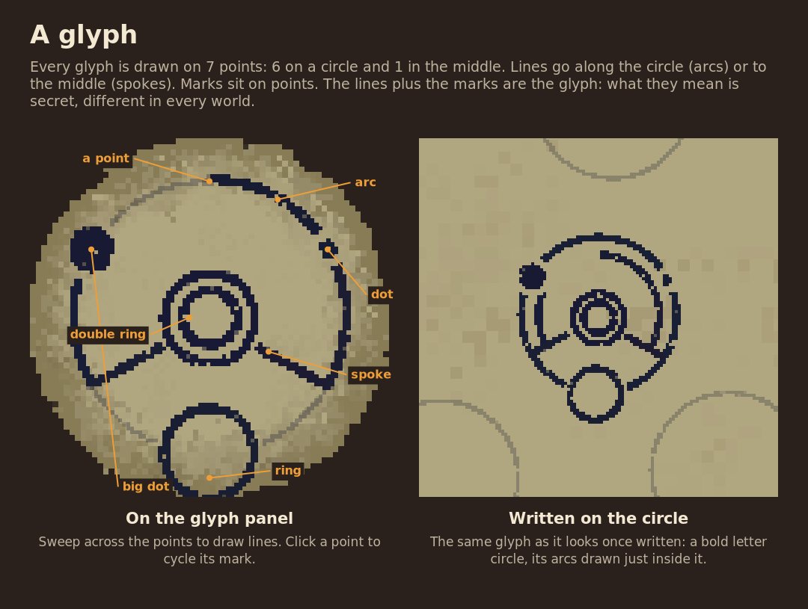
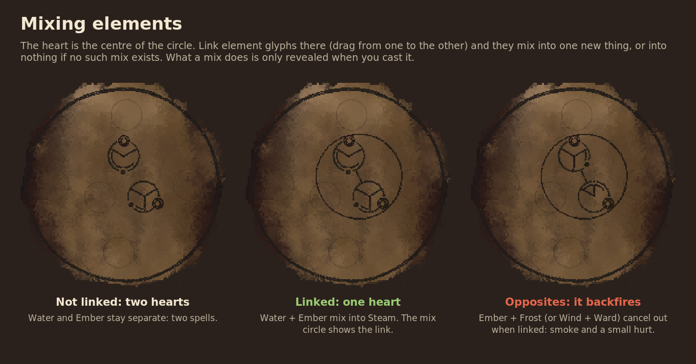
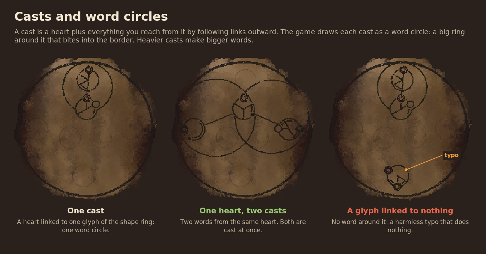
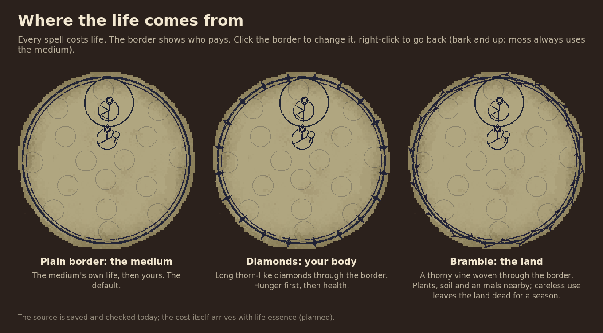
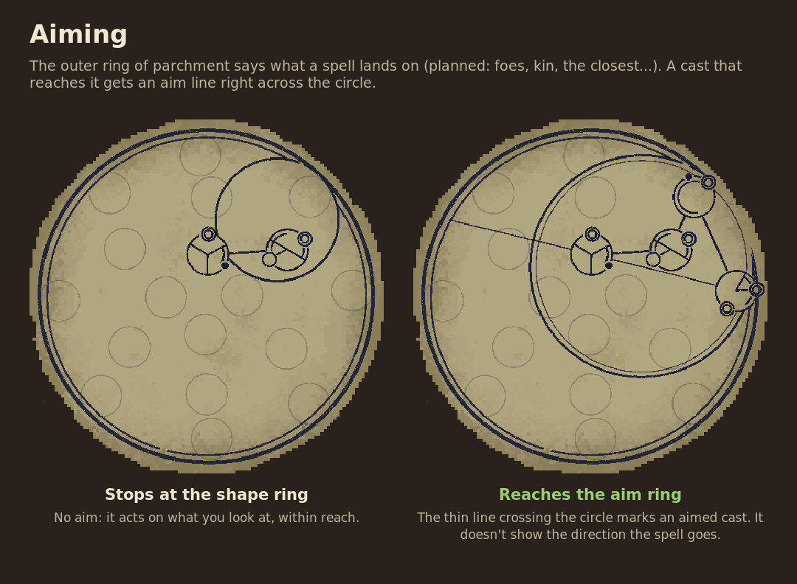
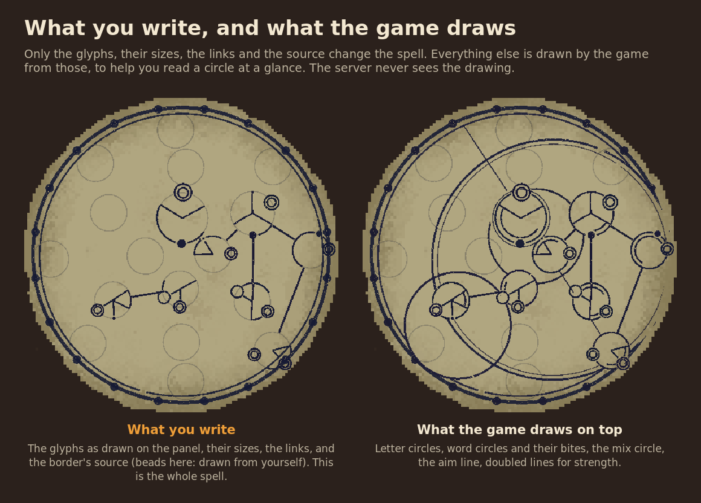
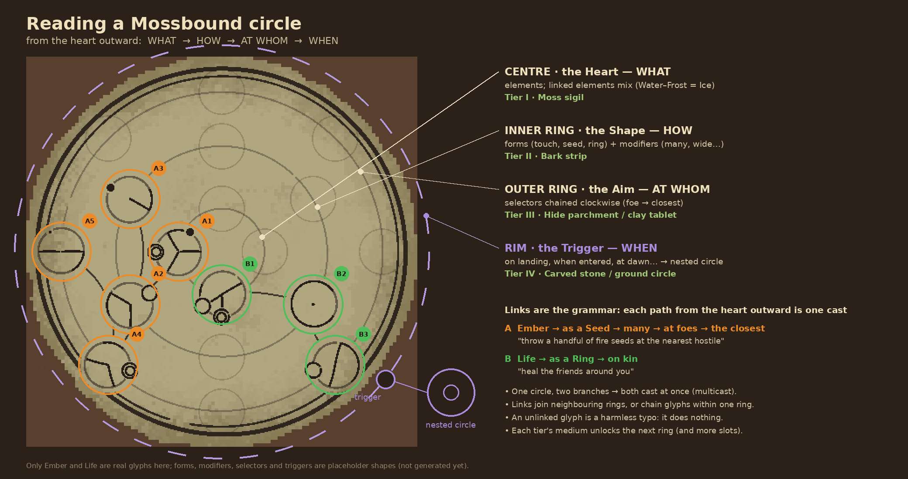

# Writing circles: a visual guide

A spell is a circle you write on a medium (moss, bark, parchment) and then cast. Look at the pictures in order: each one adds one idea. Every circle shown is drawn by the game's own code.

Things marked *(planned)* are designed but not in the game yet.

## 1. A glyph

## 2. Strength

## 3. Mixing

## 4. Casts

Form glyphs for the shape ring (Touch, Seed, Ring...) are *(planned)*. Until they exist every spell acts by touch, and the pictures use element glyphs as stand-ins.

## 5. Where the life comes from

## 6. Aiming

## 7. What you write, and what the game draws

## 8. The media

## All together

---

## Reference

### What changes the spell

| On the circle | Changes the spell? |
|---|---|
| Glyphs (lines and marks) | Yes: the words themselves |
| Which ring a glyph is on | Yes: elements belong in the heart |
| Glyph size | Yes: strength |
| Links | Yes: which hearts mix, which glyphs form a cast |
| Border style (source) | Yes *(the cost is planned)* |
| Mix circles, word circles, bites, aim lines, doubled lines | No: drawn by the game to help you read |
| Slot unevenness, empty slots, highlights | No: drawing and interface only |

### When it goes wrong

| Mishap | Cause | Result |
|---|---|---|
| Opposites | Ember with Frost, or Wind with Ward, linked in one heart | Backfires: smoke and a small hurt |
| Overload | More than 3 of one element in a heart | Backfires |
| Misplaced | An element glyph outside the heart | Fizzles |
| Nothing to cast | No element in the heart | Fizzles |

### Controls

| Where | Action | Does |
|---|---|---|
| Circle | Left click a slot | Select it |
| Circle | Left drag / right drag between glyphs | Link / unlink |
| Circle | Mouse wheel over a glyph | Change its size |
| Circle | Click / right-click the border | Next / previous source (bark and up) |
| Panel | Sweep / right-button sweep across points | Draw / erase lines (a skipped point is routed along the rim or through the middle) |
| Panel | Click / right-click a point | Cycle / clear its mark |
| Buttons | Clear glyph, Inscribe | Wipe the selected glyph; send the circle to the server, which checks it and writes it on the medium |
| In hand | Hold right-click | Cast (on what you look at, or you) |
| In hand | Sneak + right-click | Edit again |

### Casting today
Hold right-click for a second. Every aspect shows a burst of its colour; Life heals, Ember burns creatures and Wind pushes them. Spells never hurt or push other players. Two seconds between casts. The medium is used up, except in creative mode.

### Planned
Modifier marks on forms (dots for count, lines for reach, small circles for duration, ticks for speed; outside the letter means more, inside less), carved stone with rim triggers and circles that call other circles, the real cost of life essence, and learning glyphs from the world. See `design.md`.
