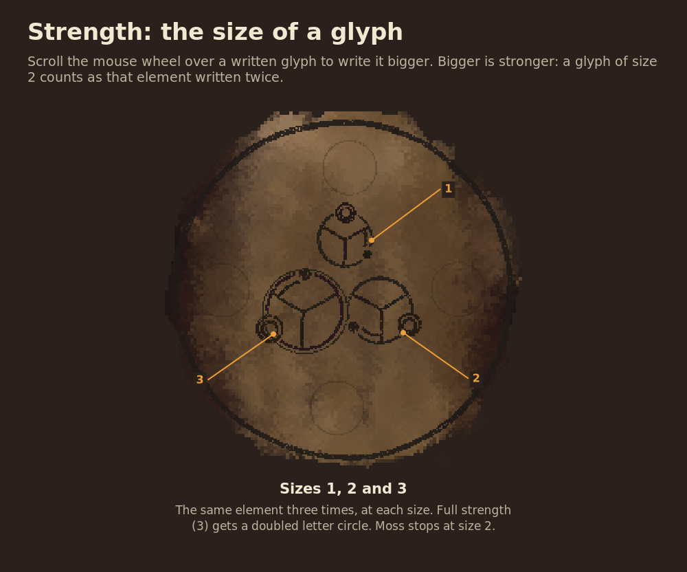
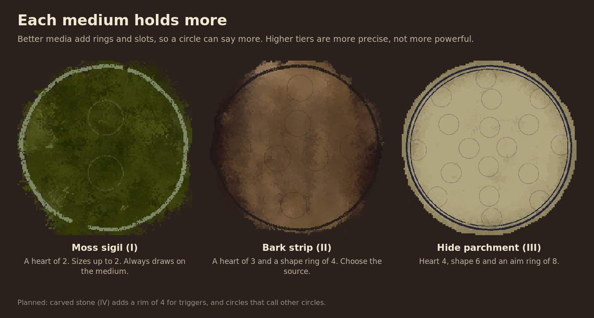

# Writing circles

How to write and cast a spell, one concept per picture. Every circle shown is drawn by the game's own code. Items marked *(planned)* are designed but not in the game yet. The full rules are in [design.md](design.md).

## Getting started

1. Get a medium. Bark strip: craft a knife with a placed log in the crafting grid. Moss sigil and hide parchment: creative inventory for now.
2. Hold the medium and right-click. The inscription window opens.
3. Write glyphs, link them, and press **Inscribe**. The server checks the circle and writes it on one medium.
4. Hold right-click with the inscribed medium for one second to cast it. Sneak + right-click edits it again.

## 1. A glyph

A glyph is a word. You draw it on the glyph panel; the circle shows it in place.

## 2. Strength

The size of a glyph sets how strong it is.

## 3. Mixing

Element glyphs linked together in the heart mix into one result.

## 4. Casts

A cast is a heart and everything linked outward from it. One circle can hold several casts.

Form glyphs for the shape ring (Touch, Seed, Ring...) are *(planned)*. Until they exist every spell acts by touch, and these pictures use element glyphs as stand-ins.

## 5. Source

The border shows what pays for the spell: the medium, you, or the land.

## 6. Aiming

A cast that reaches the aim ring is aimed. Aim glyphs are *(planned)*.

## 7. Written versus drawn

Only part of what you see changes the spell. The game draws the rest to make the circle readable.

## 8. Media

Better media have more rings and slots.

## Full circle

## Reference

### What changes the spell

| On the circle | Changes the spell? |
|---|---|
| Glyphs (lines and marks) | Yes: they are the words |
| The ring a glyph is on | Yes: elements must be in the heart |
| Glyph size | Yes: strength |
| Links | Yes: which hearts mix, which glyphs form a cast |
| Border pattern (source) | Yes: who pays *(the cost is planned)* |
| Mix circles, word circles, bites, aim lines, doubled lines | No: drawn by the game |
| Slot positions, empty slots, highlights | No: interface only |

### When it goes wrong

| Mishap | Cause | Result |
|---|---|---|
| Opposites | Ember with Frost, or Wind with Ward, in one heart | Backfires: smoke and slight damage to you |
| Overload | More than 3 of one element in a heart (sizes add up) | Backfires |
| Misplaced | An element glyph outside the heart | Fizzles |
| Nothing to cast | No element in any heart | Fizzles |

If any heart fails, the whole circle fails.

### Controls

| Where | Action | Result |
|---|---|---|
| Circle | Left click a slot | Select it |
| Circle | Left drag / right drag between two glyphs | Link / unlink them |
| Circle | Mouse wheel over a glyph | Change its size |
| Circle | Click / right-click the border | Next / previous source (bark and up) |
| Panel | Sweep across points / sweep with the right button | Draw / erase lines. A skipped point is routed along the rim or through the middle |
| Panel | Click / right-click a point | Cycle / clear its mark |
| Buttons | Clear glyph | Erase the selected glyph |
| Buttons | Inscribe | Send the circle to the server, which checks it and writes it on the medium |
| In hand | Hold right-click | Cast, on what you look at, or on yourself |
| In hand | Sneak + right-click | Edit the circle again |

### Casting today
Every aspect shows a burst of its colour. Life heals, Ember burns creatures, Wind pushes creatures away. Spells never damage or push other players. Two seconds between casts. The medium is used up, except in creative mode.

### Planned
Form, behaviour and aim glyphs; modifier marks on forms; carved stone with triggers and nested circles; the life-essence cost; making media in the world; learning glyphs from the world. See [design.md](design.md) and the [roadmap](roadmap.md).
